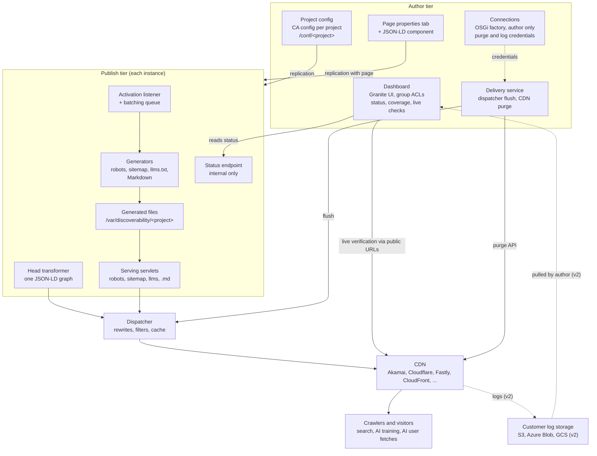
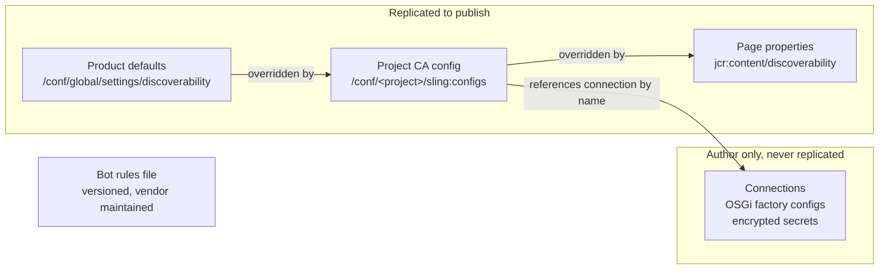
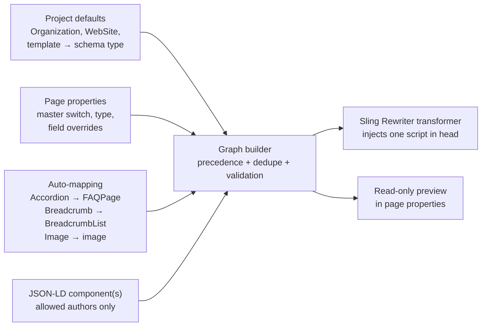
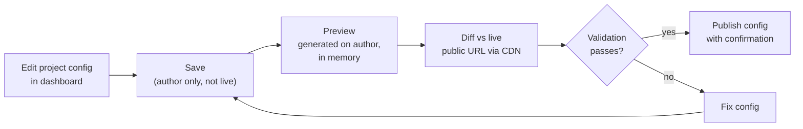
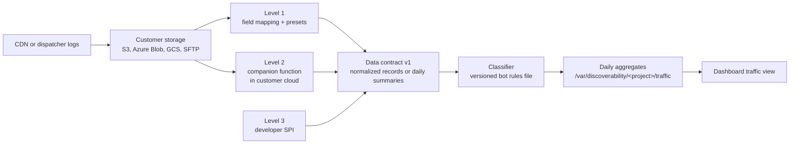
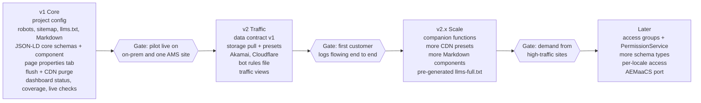

# AEM Discoverability Suite — Architecture

> **SUPERSEDED for v1 implementation.** Source of truth is [`docs/plan/`](plan/). This document describes an earlier activation/`/var`/dashboard model that is **out of scope for v1**. Do not implement from this file.

**Product:** AEM Discoverability Suite
**Repository:** `aem-discoverability-suite`
**groupId / Java package:** `com.aem.discoverability`
**appId:** `discoverability` (`/apps/discoverability`, `/conf/<project>/settings/discoverability`)
**Baseline:** AEM 6.5.17+ (on-premise and AMS), validated on 6.5 LTS · Java 11 · Maven 3.3.9+ · AEM Project Archetype 57

---

## 1. Purpose

A single installable AEM package that makes any site discoverable by search engines (SEO), answer engines (AEO) and generative AI engines (GEO), configured **per project** without code changes.

It generates and serves:

| Output | Discipline | Purpose |
|---|---|---|
| `robots.txt` | SEO / GEO | Crawl rules, including per-AI-bot allow/deny |
| `sitemap.xml` (+ sitemap index) | SEO | URL discovery, hreflang alternates, lastmod |
| `llms.txt` / `llms-full.txt` | GEO | Curated index of the site for LLMs (llmstxt.org format) |
| `page.md` renditions | GEO | Clean Markdown version of each page |
| JSON-LD structured data | AEO | Entity and content structure in the page head |

Plus an **author-only Granite UI dashboard** that shows what the live site actually serves.

### Design principles

1. **Install and configure, never customise.** Features are enabled per project through configuration.
2. **Live truth only.** Output reflects published content, never author drafts.
3. **Secrets never leave author.** Credentials live in author-only OSGi config and are never replicated.
4. **Universal, not vendor-locked.** CDN integrations use adapters and presets behind one contract.
5. **Clean coexistence.** Never write to `/libs`, never silently override existing SEO setups, uninstall cleanly.

---

## 2. System architecture



**Reading the diagram:** author owns configuration, credentials and the dashboard. Publish generates everything content-derived from what is actually live. Dispatcher and CDN serve the output as static, cached files until the next relevant publish replaces it.

---

## 3. Platforms

| Platform | Status | Notes |
|---|---|---|
| AEM 6.5.17+ on-premise | Supported | Customer controls dispatcher, OSGi config and network egress |
| AEM 6.5.17+ on AMS | Supported | Dispatcher, production config and egress changes go through the Adobe CSE |
| AEM 6.5 LTS | Validated | Test on Java 17/21 runtime |
| AEM as a Cloud Service | Not in v1 | Avoid deprecated APIs so a port stays possible |
| Edge Delivery Services | Out of scope | Different delivery model |

---

## 4. Repository and module structure

Generated with AEM Project Archetype 57, then reshaped from a site project into a product package.

```
aem-discoverability-suite/
├── core/                         OSGi bundle  com.aem.discoverability.core
│   └── src/main/java/com/aem/discoverability/core/
│       ├── platform/             config resolver, project registry, page walker,
│       │                         externalizer, environment guard
│       │                         (permission service / access groups: deferred)
│       ├── seo/                  robots.txt, sitemap.xml, sitemap index
│       ├── geo/                  llms.txt, llms-full.txt, Markdown renditions,
│       │   └── markdown/         component renderers + SPI
│       ├── aeo/                  JSON-LD contributors, schema mapping,
│       │                         head transformer, validation
│       ├── delivery/             activation listener, batching jobs, flush, CDN purge
│       │   └── cdn/              CdnAdapter SPI, Akamai, Cloudflare
│       ├── dashboard/            data servlets, live verification, status client/endpoint
│       └── analytics/            (v2) log ingestion, mapping, classification
├── ui.apps/                      /apps/discoverability
│   ├── components/jsonld/        JSON-LD component
│   ├── dialogs/page-properties-tab/
│   ├── content/dashboard/        Granite UI console
│   └── clientlibs/               dashboard JS/CSS, small chart library
├── ui.apps.structure/
├── ui.config/                    repoinit, OSGi defaults per run mode
├── ui.content/                   /conf/global/settings/discoverability (merge)
├── dispatcher/                   reference snippets only, NOT in the all package
└── all/                          the single installable package
```

| Module | Installs to | Run modes |
|---|---|---|
| core (platform, seo, geo, aeo, delivery) | OSGi bundle | author + publish |
| core (dashboard, analytics) | OSGi bundle, services bound by config | author (status endpoint on publish) |
| ui.apps | `/apps/discoverability`, Tools nav entry | all |
| ui.config | repoinit, OSGi configs | per run mode |
| ui.content | `/conf/global/settings/discoverability` | all, merge mode |

**Packaging rules:** never write to `/libs`; narrow filter roots; embed third-party libraries (jsoup, flexmark) with bnd; the dispatcher module is documentation, not deployed.

---

## 5. Configuration model



| Layer | Holds | Edited by |
|---|---|---|
| Product defaults | Safe defaults for every field | Vendor |
| Project CA config | Feature toggles; robots, sitemap, llms.txt, Markdown settings; JSON-LD defaults (organization, template-to-schema mapping); connection name | Authors via dashboard |
| Page properties | JSON-LD switch, type, overrides; Markdown exclude, LLM description, section, selector override | Page authors |
| Connections (OSGi factory) | Provider, endpoints, zone/bucket, keys or instance identity | Admins / DevOps |
| Bot rules file | Bot categories, user-agent patterns, verification sources | Vendor |

**Projects.** Each project (A, B, C …) is registered in the dashboard and referenced from its content root by `sling:configRef`. MSM locale trees inherit project config and override locale-specific fields.

**Feature toggles.** robots, sitemap, llms.txt, Markdown and JSON-LD are independent toggles; enabling one reveals its settings (Granite show/hide).

**Environment guard.** Non-production environments always serve disallow-all robots.txt and never list production URLs, regardless of project config. The environment type is set per run mode by OSGi config.

**Schema versioning.** Every field has a code default; upgrades run migrations when a field's meaning changes.

---

## 6. Generation pipeline

| Output | Source | Generated on | Trigger |
|---|---|---|---|
| robots.txt | Project config only | Publish, from replicated config (author validates and previews) | Config publish |
| sitemap.xml (+ index) | Live pages, URLs, replication dates | Publish | Page activation/deactivation, config publish |
| llms.txt / llms-full.txt | Live pages, titles, descriptions, sections | Publish | Page activation/deactivation, config publish |
| `page.md` | Page content via component renderers | Publish | That page's activation; config publish regenerates all |
| JSON-LD | Defaults, page properties, auto-mapping, JSON-LD components | Publish, at render time | Every page render (cached with HTML) |

```mermaid
sequenceDiagram
    autonumber
    actor Author
    participant A as Author instance
    participant P as Publish instance
    participant Q as Batching queue (Sling Jobs)
    participant G as Generators
    participant V as /var/discoverability
    participant D as Dispatcher
    participant C as CDN

    Author->>A: Publish page or project config
    A->>P: Replication
    P->>Q: Resource change on /content/&lt;project&gt; or /conf/&lt;project&gt;
    Note over Q: Coalesce events, wait for quiet period
    Q->>G: One regeneration job per project
    G->>G: Walk live pages (skip CUG, excluded, hidden)
    G->>V: Write robots, sitemap(s), llms.txt, changed .md files
    G-->>A: Status available via internal endpoint
    A->>D: Flush affected files
    A->>C: Purge affected URLs (if connection configured)
    C-->>Author: Crawlers now receive fresh output
```

**Batching.** A tree activation of 1,000 pages produces one sitemap rebuild, not 1,000. The dashboard shows pending changes and the last regeneration time.

**Removal and change.** Deactivated or deleted pages drop out of the sitemap and llms.txt, and their Markdown is deleted. Moves and renames update URLs. Scheduled on/off times, workflow publishing and MSM rollout plus publish all hit the same triggers.

**Correctness rules.**
- Only anonymous-visible pages (no closed user groups), not excluded by template, page flag or hidden status.
- URLs are externalized through the Externalizer and resource resolver mapping (`/etc/map`).
- Sitemap `lastmod` = last replication date; split into a sitemap index at 50,000 URLs or 50 MB.

**Markdown (v1 component set).** Title, Text, Image (alt text), List, Teaser, Container traversal. Proxy components resolve through the `sling:resourceSuperType` chain. Unsupported components are skipped and reported as per-page coverage. Each file starts with front matter (title, description, canonical URL, last modified). Customers add renderers through the `MarkdownComponentRenderer` SPI.

---

## 7. JSON-LD and page properties



**Page properties tab** (one include node added to the customer's base page dialog; stored under `jcr:content/discoverability`):

| JSON-LD field | Default when empty |
|---|---|
| Enable on this page (master switch for all JSON-LD, including components) | On when project feature enabled |
| Schema type | Template-to-schema mapping |
| Map from components | On |
| Field overrides (headline, description, author, date, image) | Page title, description, featured image, replication date |
| Custom JSON-LD (admins only) | Off |
| Preview (read-only, shows source of each node) | — |

| Markdown field | Default when empty |
|---|---|
| Exclude from Markdown and llms.txt | Off |
| LLM description | Page description |
| llms.txt section | Derived from page tree |
| Content selector override | Project setting |
| Preview (draft, labelled) | — |

**JSON-LD component.** For structured data that no visible component supplies (event details, product specs, extra FAQ entries). The dialog shows fields per schema type with required fields enforced. It renders nothing visible on publish and a summary card in edit mode. Several instances merge into the page graph.

**Precedence.** Component beats auto-mapping for the same type; page-property field overrides apply on top; the preview shows the source of every node.

**Access.** The component lives in its own component group and is allowed per template policy. Read on the component definition in `/apps` is denied to authors outside the allowed group.

**Safety.** Required properties are validated per type; custom JSON-LD must parse and is escaped so it cannot break out of its script tag; existing same-type JSON-LD on the page is skipped unless configured to replace. Content drift between component data and visible content is flagged in the dashboard. Without the transformer, the component outputs in the body as a documented fallback.

---

## 8. Delivery and caching

| Layer | Mechanism |
|---|---|
| Dispatcher | Reference snippet maps `/robots.txt`, `/sitemap.xml`, `/llms.txt`, `/llms-full.txt`, `*.md` per vhost to the project's content root, allows them through filters and caches them. Root-level files are flushed explicitly after regeneration. |
| CDN, TTL mode (default) | Moderate TTLs; shorter for robots, sitemap and llms.txt than for Markdown |
| CDN, purge mode | When a project references a connection, the delivery service calls the provider's purge API after the dispatcher flush |

The `CdnAdapter` SPI ships Akamai (Fast Purge) and Cloudflare (purge by URL) in v1. Fastly, CloudFront, Azure Front Door and Google Cloud CDN follow as presets. The same connection is reused for log retrieval in v2.

---

## 9. Dashboard

Granite UI console under **Tools → General → Discoverability**, active on author only. Every number reflects publish and the live site.

| View | Contents |
|---|---|
| Overview | All projects the user may see: features enabled, live status, last regeneration, open issues |
| Project detail | Config editor, pending vs live diff, generated output, Markdown coverage, schema validity, live checks |
| Traffic (v2) | Search crawlers, AI training crawlers, AI user-triggered fetches; date range |

**Project filter:** hierarchical (project → locale), filter by condition (has issues, live check failing, unpublished config, feature enabled), selection kept in the URL and remembered per user.

| Live data source | How |
|---|---|
| Replication status | Config published vs pending; agent queue health |
| Publish status endpoints | Internal-only, per instance, blocked at dispatcher, technical credential |
| Live verification | Author fetches the public URLs through the CDN and compares with expected output |
| CDN logs (v2) | Universal data contract, pulled from customer storage |

### Preview before publish

Every output has a **Preview** link in the dashboard, so authors can see exactly what a saved but unpublished context-aware configuration will produce before they publish it.



| Output | Preview link shows | Fidelity |
|---|---|---|
| robots.txt | Full file from saved config | Exact: depends only on config |
| sitemap.xml | Entry count, first 200 entries, full download; index split if needed | Exact page list (activated pages only); lastmod from replication dates |
| llms.txt / llms-full.txt | Full file | Page list exact; titles and descriptions come from author and may include unpublished edits, which are highlighted |
| Markdown (per page) | Rendered `.md` for any page picked from the project tree | Content from author; unpublished edits highlighted |
| JSON-LD (per page) | Merged graph with the source of each node | Content from author; unpublished edits highlighted |

**Each output card in the project view has three links:** Preview (saved config, generated now on author), Live (the public URL through the CDN), and Diff (preview against live, line by line). The Publish config button shows the diff summary and validation results in its confirmation dialog; dangerous robots rules block publishing until fixed.

**Same code path.** Generators are pure functions of a `GenerationContext` (effective config + page source + writer). On publish the context uses published config and content and writes to `/var`. For preview, the context uses author's saved config and a page source filtered to **activated pages only**, and writes to the response, never to `/var` and never cached.

**Page-level preview.** The page properties tab links to the page's Markdown and JSON-LD previews, labelled as draft, so authors can check their overrides before publishing the page.

**Rules.**
- Preview servlets run on author only (standard AEM author session; access groups deferred) and are denied on publish by the dispatcher snippet.
- Preview reflects **saved** config. Unsaved form values are not previewed in v1; robots.txt validation runs live as the user types.
- Preview shows which environment it represents. On non-production authors, the environment guard output (disallow-all robots) is shown alongside the configured rules, so users see both.
- Optional toggle "include unpublished pages" previews what a future launch would add to the sitemap and llms.txt; off by default.

---

## 10. Access control

**v1 (now):** No product access groups. The dashboard and its data/preview servlets are available to any authenticated AEM author who can reach Tools. Connections and secrets remain author-run-mode OSGi only (not editable via replicated `/conf`). Rely on standard AEM ACLs on `/conf` and `/content`; do not invent `discoverability-admins` / `discoverability-users` / per-project mapped groups yet.

**Deferred:** `PermissionService`, project group mapping in CA config, overview filtering by mapped projects, and IdP-backed editors/viewers lists. When added later, every dashboard servlet must check the requesting user's session before returning service-user reads; render conditions stay UX-only.

**Still required in v1:** Service users via repoinit (`discoverability-reader`, `discoverability-writer`) for generation I/O; audit log of config changes, config publish and connection changes.

---

## 11. Traffic analytics (v2)



- Fields: timestamp, host, path, status, user agent, IP or IP verdict, cache status, CDN bot verdict.
- Categories: search crawlers, AI training crawlers, AI user-triggered fetches; verified vs claimed.
- Only aggregates are stored; raw logs never enter the JCR; raw IPs are dropped after classification.
- Human traffic comes from the customer's analytics, not logs.

---

## 12. Security

- Dashboard, data servlets, connections and analytics run on author only; dispatcher blocks their paths on publish.
- Secrets in author-only OSGi factory configs, encrypted per environment, never in Git in plain text; instance identity (IAM role, managed identity) as a keyless option.
- Least-privilege keys per purpose (read-only log bucket, purge-only zone); credentials hot-reload; expiry warnings.
- Credentials never appear in logs, errors or UI.
- Publish status endpoints: internal only, technical credential.
- Service users via repoinit, read-only where possible; every request checked against the calling user first.
- Generated content excludes closed-user-group and unpublished content by construction.

---

## 13. Platform differences

| Concern | On-premise | AMS |
|---|---|---|
| Dispatcher rules | Customer applies snippet | One combined CSE request (template provided) |
| Connection secrets | Admin enters per environment | Encrypted values per environment in deployment, or CSE request |
| Outbound egress | Customer firewall | May need Adobe request |
| Logs (v2) | Customer ships logs | CDN logs via customer storage |

---

## 14. Roadmap



---

## 15. Risks

| Risk | Impact | Mitigation |
|---|---|---|
| A bad robots rule deindexes a site | High | Dangerous-pattern validation, preview and diff, history and rollback, environment guard |
| Conflicts with existing sitemap/robots setups | High | Detect on install, per-feature opt-in, never override silently |
| CDN serves stale output | Medium | Purge where connected, short TTLs otherwise, live verification flags it |
| AMS onboarding stalls on CSE changes | Medium | Single combined CSE request template |
| Thin Markdown on custom-component sites | Medium | Coverage reporting, supertype resolution, renderer SPI |
| Structured data drifts from visible content | Medium | Prefer auto-mapping, drift checks in dashboard |
| Upgrades break older configs | Medium | Code defaults, versioned schema, migrations |

## 16. Decisions log

| Decision | Choice |
|---|---|
| Dashboard technology | Granite UI on author only |
| Where content-derived files are generated | Publish, on activation, batched |
| Where secrets live | Author-only OSGi factory configs |
| Who can edit robots rules | Any authenticated author with dashboard access (v1); tighten with access groups later |
| Access model | v1: no product access groups — standard AEM author session; `PermissionService` + project-mapped groups deferred |
| JSON-LD | In v1, with page properties tab and JSON-LD component, one merged graph in head |
| Traffic analytics | v2, CDN logs through a universal data contract |
| Baseline | AEM 6.5.17+, Java 11, archetype 57 |
| Preview before publish | Preview, Live and Diff links per output; author-only, in-memory, same generators as publish, saved config only |
